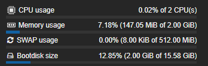

<div align="center">

# 🎵 Personal Music App

**My Music. My Server. My Rules.**

A personal music application built with Android Studio and .NET 8.


**Kotlin · C# · ASP.NET Core · SQLite**

</div>

---

## Why I Built It

I got tired of Spotify's advertisements and limitations, so I decided to build my own music application that gives me more control over how I discover and listen to music.

I wanted an Android app where I could search for music through YouTube, stream tracks, save favorites, download supported music for offline listening, and customize the interface to my preferences.

I also wanted to understand how a complete application works behind the scenes, so I developed my own C# .NET 8 backend and connected it to the Android app using HTTP requests.

To keep costs low and maintain control over my infrastructure, I host the backend in a Proxmox LXC container running Debian 12, dedicated to my .NET API and SQLite database.

This project combines Android development, backend engineering, audio streaming, and self-hosting into one personal project that I can continuously improve and customize.

## Features

| Feature | Description |
|---|---|
| Music Discovery | Search for songs and artists. |
| Audio Streaming | Listen to supported tracks through the application. |
| Personal Library | Save and manage favorite songs. |
| Offline Listening | Download supported tracks where legally permitted. |
| Custom Themes | Customize the application's accent colors. |
| Audio Caching | Cache audio data to reduce repeated processing and improve performance. |
| Real-Time Communication | SignalR support for communication between connected clients. |
| Self-Hosting | Run the backend on my own home server. |

---

## Architecture

The project consists of two main components: an Android application and a .NET backend API.

```text
┌──────────────────────────────────┐
│        Android Application       │
│                                  │
│  Kotlin + Jetpack Compose        │
│                                  │
│  Home · Search · Discover        │
│  Library · Player · Settings     │
└────────────────┬─────────────────┘
                 │
                 │ HTTP / API Requests
                 ▼
┌──────────────────────────────────┐
│          .NET 8 Backend          │
│          ASP.NET Core            │
│                                  │
│  Search · Audio · Playback       │
│  Liked Songs · API Middleware    │
└────────┬─────────────┬───────────┘
         │             │
         ▼             ▼
┌────────────────┐  ┌──────────────┐
│    Services    │  │    SQLite    │
│                │  │              │
│ YouTube Search │  │ Liked Songs  │
│ Audio Caching  │  │ Playback Data│
└────────────────┘  └──────────────┘
         │
         ▼
┌──────────────────────────────────┐
│          Proxmox Server          │
│                                  │
│  Debian 12 · LXC Container       │
│  .NET API · SQLite               │
└──────────────────────────────────┘
```

## Android Application

Built with Kotlin, Android Studio, and Jetpack Compose, the Android application provides the interface for discovering music and managing a personal library.

| File | Responsibility |
|---|---|
| `MainActivity.kt` | Main activity and application entry point. |
| `Screens.kt` | Home, search, discover, library, artist, and settings screens. |
| `Audio.kt` | Audio and playback functionality. |
| `Model.kt` | Track models, server configuration, networking helpers, and shared utilities. |
| `ui/theme/` | Application theme resources. |

### Connecting to My Server

The `Config` object in `Model.kt` manages the backend URL and API key configuration.

```kotlin
object Config {
    var baseUrl: String = "http://YOUR_SERVER_IP:5080"
    var secret: String = ""

    fun save(ctx: Context, url: String, sec: String) {
        baseUrl = url.trim().trimEnd('/')
        secret = sec.trim()

        ctx.getSharedPreferences("pm", Context.MODE_PRIVATE)
            .edit()
            .putString("baseUrl", baseUrl)
            .putString("secret", sec)
            .apply()
    }
}
```

This allows the application to save its server settings locally, making it possible to configure the backend without changing the source code.

### Searching for Music

The Android client sends HTTP requests to the backend and converts the JSON response into Kotlin `Track` objects.

```kotlin
fun searchServer(q: String): List<Track>? {
    return try {
        val url = Config.baseUrl +
            "/api/search?query=" +
            URLEncoder.encode(q, "UTF-8")

        val connection = apiGet(url)
        val response = connection.inputStream
            .bufferedReader()
            .use { it.readText() }

        val tracks = JSONObject(response)
            .getJSONArray("tracks")

        val results = ArrayList<Track>()

        for (i in 0 until tracks.length()) {
            val track = tracks.getJSONObject(i)

            val id = track.optString("id")
            val title = track.optString("title")
            val stream = track.optString("streamUrl")

            if (id.isEmpty() || title.isEmpty() || stream.isEmpty()) {
                continue
            }

            results.add(
                Track(
                    id,
                    title,
                    track.optString("artist"),
                    track.optString("artwork"),
                    stream,
                    track.optString("source")
                )
            )
        }

        results
    } catch (e: Exception) {
        null
    }
}
```

This example demonstrates how the Android application requests search results, processes the JSON response, and creates track models for the interface.

### Displaying Music Search Results

Jetpack Compose allows music search results to be displayed through reusable UI components.

```kotlin
@Composable
fun TrackItem(
    track: Track,
    onClick: () -> Unit,
    modifier: Modifier = Modifier
) {
    Row(
        modifier = modifier
            .fillMaxWidth()
            .clickable(onClick = onClick)
            .padding(12.dp),
        verticalAlignment = Alignment.CenterVertically
    ) {
        AsyncImage(
            model = track.artwork,
            contentDescription = "Album artwork for ${track.title}",
            modifier = Modifier
                .size(56.dp)
                .clip(RoundedCornerShape(8.dp)),
            contentScale = ContentScale.Crop
        )

        Spacer(modifier = Modifier.width(12.dp))

        Column(
            modifier = Modifier.weight(1f)
        ) {
            Text(
                text = track.title,
                style = MaterialTheme.typography.titleMedium,
                maxLines = 1,
                overflow = TextOverflow.Ellipsis
            )

            Text(
                text = track.artist,
                style = MaterialTheme.typography.bodyMedium,
                maxLines = 1,
                overflow = TextOverflow.Ellipsis
            )
        }

        Icon(
            imageVector = Icons.Default.PlayArrow,
            contentDescription = "Play ${track.title}"
        )
    }
}
```

This component displays each track with its artwork, title, artist, and a play icon. The `onClick` callback allows the parent screen to connect the component to the application's existing playback functionality.

The example assumes the project uses Coil for `AsyncImage` and Material icons.

---

## .NET Backend

The backend uses C# and ASP.NET Core, with separate files for HTTP endpoints, middleware, services, and database operations.

### HTTP Endpoints

| File | Responsibility |
|---|---|
| `HealthEndpoints.cs` | Server health checks. |
| `SearchEndpoints.cs` | Music search requests. |
| `AudioEndpoints.cs` | Audio-related requests and streaming. |
| `LikedSongEndpoints.cs` | Managing favorite songs. |
| `PlaybackEndpoints.cs` | Playback state management. |

### Health Check Endpoint

A health endpoint provides a simple way to check whether the API is responding.

```csharp
app.MapGet("/api/health", () =>
    Results.Ok(new
    {
        status = "healthy",
        service = "Personal Music API"
    }));
```

This endpoint returns a JSON response indicating that the service is available.

### Music Search Endpoint

The search endpoint accepts a query from the Android application and passes it to the music search service.

```csharp
app.MapGet("/api/search", async (
    string query,
    YouTubeService musicService) =>
{
    if (string.IsNullOrWhiteSpace(query))
    {
        return Results.BadRequest(new
        {
            error = "A search query is required."
        });
    }

    var tracks = await musicService.SearchAsync(query);

    return Results.Ok(new { tracks });
});
```

This illustrates how an endpoint can validate a search query, delegate the work to a service, and return the results as JSON.

The method name and return type should match the actual implementation of `YouTubeService.cs`.

### Saving Favorite Songs

The database layer handles persistent storage, allowing favorite songs to remain available between application sessions.

```csharp
app.MapPost("/api/liked-songs", async (
    Track track,
    MusicDatabase database) =>
{
    await database.AddLikedSongAsync(track);

    return Results.Ok(new
    {
        message = "Song saved successfully."
    });
});
```

This example illustrates how an endpoint can accept track data and delegate the database operation to `MusicDatabase`.

The database method and request model should match your existing implementation.

### API Key Middleware

`ApiKeyMiddleware.cs` centralizes API key validation in the HTTP request pipeline, keeping authentication separate from individual endpoint handlers.

```csharp
public async Task InvokeAsync(HttpContext context)
{
    var providedKey = context.Request
        .Headers["X-API-Key"]
        .FirstOrDefault();

    if (string.IsNullOrWhiteSpace(providedKey) ||
        providedKey != _configuredApiKey)
    {
        context.Response.StatusCode =
            StatusCodes.Status401Unauthorized;

        await context.Response.WriteAsJsonAsync(new
        {
            error = "Unauthorized"
        });

        return;
    }

    await _next(context);
}
```

This example illustrates the validation logic. It assumes `_configuredApiKey` and `_next` are initialized through the middleware constructor.

In a production deployment, protect the configured key, use HTTPS over untrusted networks, and ensure public endpoints are handled according to your authentication requirements.

### Services and Database

| Component | Responsibility |
|---|---|
| `YouTubeService.cs` | YouTube-related search and media operations. |
| `AudioCacheService.cs` | Managing cached audio data. |
| `MusicDatabase.cs` | Database operations. |
| SQLite and Dapper | Persistent storage and database access. |
| `MusicHub.cs` | SignalR real-time communication. |

The service layer separates music-related operations from HTTP request handling, while SQLite provides lightweight persistent storage for supported application data.

---

## Self-Hosted Infrastructure

I host my backend inside a **Proxmox LXC container running Debian 12**, dedicated exclusively to running my C# .NET API and SQLite database.

This lightweight setup keeps the infrastructure simple, affordable, and under my control.

<div align="center">



*Proxmox hosting the Personal Music App backend.*

</div>

---

## Project Goal

The goal wasn't simply to recreate Spotify it was to build a music application I could customize, understand, and host myself.

*Music discovery, streaming, and downloads must comply with the relevant service terms and applicable copyright law.*
